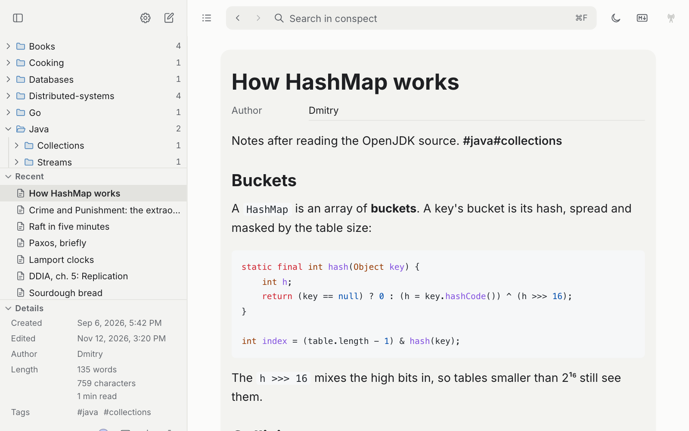
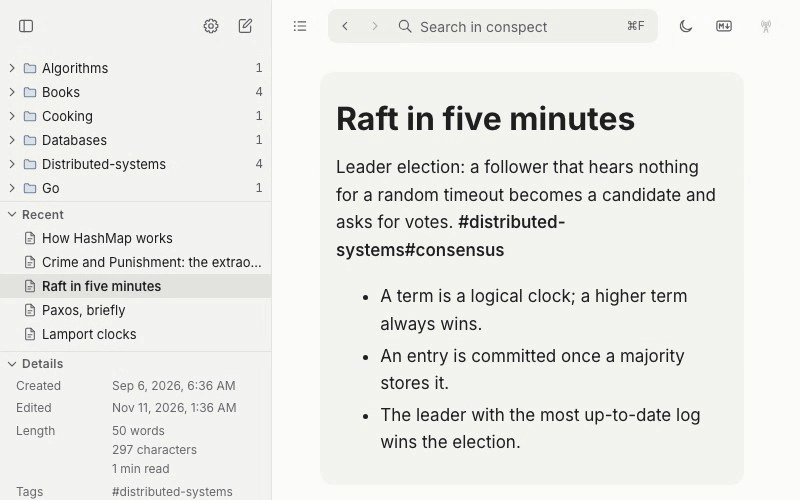
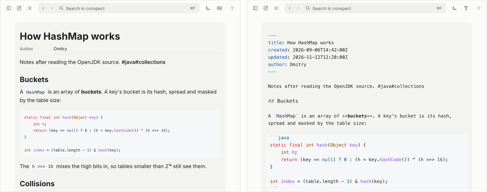
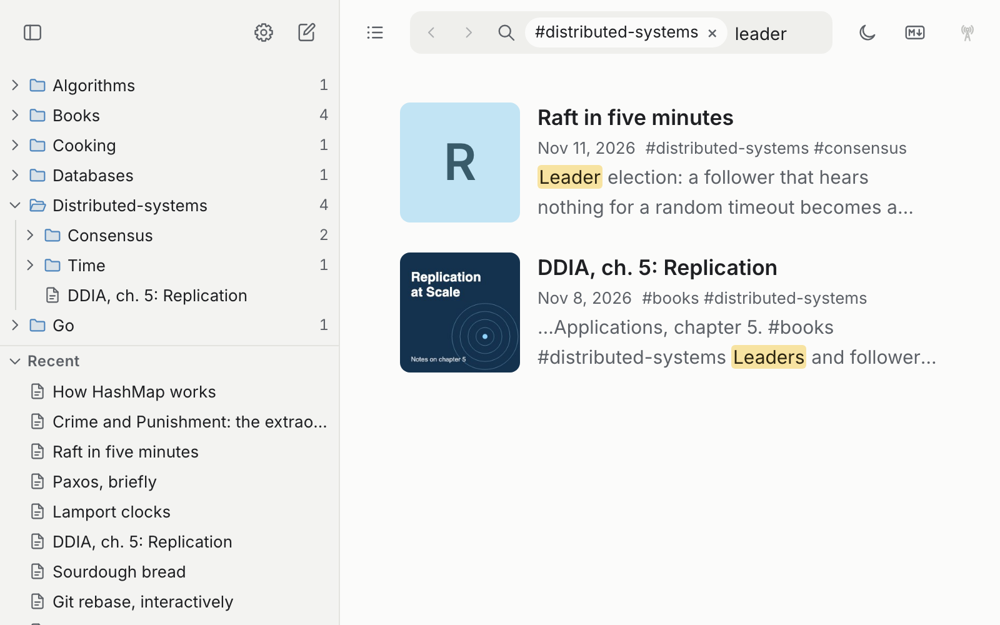
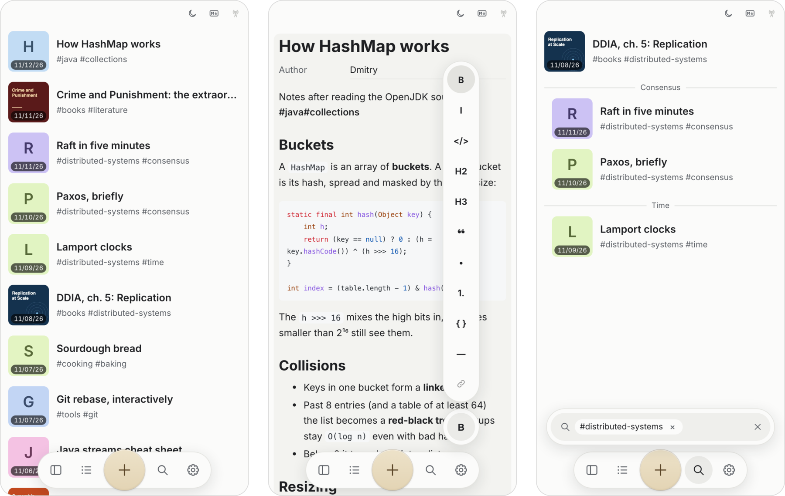

# Konspecter

**A local-first knowledge base for Markdown conspects — with Tag-Chain tags that build the tree for you.**

Every conspect is a plain **Markdown file**. Tags, search indexes and reading positions are derived from your content and can be rebuilt. Open source, works offline, and syncs through an optional self-hosted server with end-to-end encryption.

[Website](https://konspecter.com) · [Documentation](docs/) · [Releases](https://github.com/konspecter/konspecter/releases) · [Issues](https://github.com/konspecter/konspecter/issues)



> **Learn. Save. Return.** Write conspects the way you think — the tree comes out on its own.

---

## Why Konspecter?

Information is everywhere. The harder problem is often remembering **what you already learned** and quickly recovering the context you had when you learned it.

A conspect is not just a note. It is a pointer back to your own understanding:

```text
read → understand → write down → forget details
                         ↓
                  encounter a problem
                         ↓
                  find your conspect
                         ↓
               recover your understanding
                         ↓
                      apply it
```

Konspecter is built around this workflow.

**You don't build a folder hierarchy first and then write into it.** You write as you think, and the tag tree is derived from your text. The structure is a description of your notes, not a separate thing you have to maintain.

> You don't have to remember everything.
> You just need to be able to recover your own understanding when you need it.

---

## See it in action



The core workflow:

**Learn → write down → forget → search → return → apply.**

---

## Features

### Tag-Chain: tags that build the tree

Tags live directly in your text, and the hierarchy is written where it is used:

```text
#java
#java#collections
#java#collections#hashmap
```

Each `#` adds a level. Konspecter turns these tags into a tree:

```text
Java
└── Collections
    └── Hashmap
```

Tags are reusable: `#python#collections` puts the same `collections` tag under Python, while a bare `#collections` matches it under any parent. There's no separate taxonomy to keep in sync — the tree is whatever your conspects say.

Start typing a tag — `#` and a letter — in the search box or in either editor and the tags you
already use that start with those letters are offered: choose one with ↑/↓ and press Enter (or click it), or Escape to
close the list. It keeps one spelling for each tag across your library.

Choose a folder in the tree, say Java › Collections, and a new conspect made from its list
starts with that chain in its frontmatter (`java#collections` under `tags:`), so it lands in the same
folder. A tag chosen elsewhere (a link, the search box) comes alone. A conspect you leave
without writing anything is not kept.

Right-click a row in the sidebar (or press the menu key on it) for its menu: a folder offers
**Open**, a conspect **Open** and **Delete**. Delete asks first; deleting the conspect you have
open takes you back to the list.

See [TAG-CHAIN-SPEC.md](TAG-CHAIN-SPEC.md) for the full specification and examples.

### Markdown-native

Every conspect is ordinary Markdown: frontmatter, GitHub-flavored Markdown, syntax highlighting, sanitized raw HTML, import/export of `.md` files, folders and ZIP archives. Your knowledge stays in a format that doesn't belong to Konspecter.

### A colour for each conspect

In the list, a conspect without a cover shows its first letter on a colour of its own: a pastel
picked for it at random, the same every time. To choose another, click the coloured circle in its
Details (before Properties): pick any colour from the spectrum, or one of the nine you chose last,
kept in the row under it. **Default colour** goes back to the pastel. The colour is written in the
conspect's frontmatter (`color: "#4f8fd6"`), so it syncs and stays in the file.

### Local-first

Your library lives on your device and works offline: IndexedDB in the web app, installable PWA, no cloud account required for local use, offline full-text search, remembered reading position, export at any time. The hosted service is optional.

### Two editors

Konspecter provides two ways to work with the same content: a distraction-free, Telegraph-like editor, and a Markdown source editor powered by CodeMirror. Switching between them does not change what your conspect means.

The text editor's toolbar formats text and draws a horizontal line (`---`). In the text editor, put the caret in a link and a button under it opens the link; put it in
code, inline or a code block, and the button copies the code.



### Search

Combine tags with full-text search: `hashmap #java`. Search is local and works without an internet connection.

Open a conspect from the results and the same words are already searched in it: the matches are
marked and the page scrolls to the first one, so you land where the search found it. The arrows
in the search box go on to the next match.



### Desktop files

The desktop application uses a real folder of Markdown files:

```text
~/Konspecter/
├── distributed-systems.md
├── java-collections.md
├── postgres.md
└── ...
```

They can be opened alongside the tools you already use — VS Code, Vim, Git, other Markdown tools. Konspecter should fit into your workflow, not lock you into its own database format.

#### Several folders at once

Keep a personal folder, a work folder and a Git repository of notes side by side. Add a
folder with the folder-with-a-plus button next to Settings in the sidebar, or in
**Settings → Library → Add folder…**. With more than one, each folder is a root of the
sidebar's tree, holding its own tags and conspects; fold the ones you don't need, or
right-click one to show it in Finder, Explorer or Files.

**Settings → Library** lists your folders with the date each was added. From there you can
show a folder in your file manager, give it an alias (shown instead of its name), or remove
it. Removing a folder only disconnects Konspecter from it: its files and folders stay where
they are, and its conspects stay on your other devices. Any folder can be removed, the
default one too, and added again later.

Sync covers every folder. A new conspect goes into the folder of the conspect you have open,
or Konspecter asks each time (**Settings → New conspects**). Conspects that arrive from your
other devices and are new to this one go into the first folder in the list.

Make the desktop window narrow and the sidebar steps aside; make it wide again and the sidebar
comes back. If you hid the sidebar yourself, it stays hidden at any width.

### Mobile

Konspecter runs on Android through Capacitor. The same knowledge base travels with you while remaining local-first. No Play Store needed — install it from [RuStore](https://www.rustore.ru/catalog/app/app.konspecter.mobile), install the APK from the latest release, or use the PWA.

The back button (or the back gesture) works inside the app: it closes an open search, the
sidebar or a dialog, then goes back to the page you came from, and from a conspect back to the
list. Only on the list, with nowhere further back, does it leave the app.

On a phone the sidebar lists one tag folder at a time instead of a tree, so there are no small
arrows to aim at. Tap a folder's row to go into it, and the row at the top (‹ and the name
above) to go back. Inside a folder you see its own folders and conspects, then every conspect
further down, grouped by tag under a thin line with the tag's name; the deeper the tag, the
further in its conspects sit. Tap the folder's name to show its conspects in the list.
Headings are not listed under conspects there.

Swipe right to go back and left to go forward: the page you go to slides in from that side.
The sidebar slides in from the left and back out again. With reduced motion turned on in the
system, pages and the sidebar change at once.

<p align="center">
  
</p>

---

## Sync

Konspecter can synchronize your library through a Konspecter Sync Server. Sync is **optional**: your local library does not depend on it.

Conspects are end-to-end encrypted before they leave your device. When the same conspect changes on two devices, the later edit wins, and an edit always beats a deletion, so one conspect stays one conspect. See [Sync](docs/architecture/sync.md) for the details.

Each account has a storage quota on the server (512 MB unless the server sets another; the site's terms state it). Settings → Sync shows how full it is, in percent. When it is full, changes that need more room wait on your device until you delete conspects you no longer need; nothing is lost, and everything else keeps syncing.

Your account's settings on the site list the devices that sync with it. **Disconnect** stops a device syncing; it keeps its conspects. **Disconnect and wipe** is for a device you no longer have, or one that is lost or given away. It asks first. The device stops syncing at once, and the next time it goes online it erases the conspects it holds. On a computer, the Markdown files sync covers are deleted for good, not moved to the trash; other files in the folder stay. Changes it had not synced are lost; your account and your other devices keep every conspect. Until the device has wiped itself, the site lists it as waiting; **Remove from list** drops one that will never come online again (it is then no longer wiped). The next time the app starts, it says it was wiped.

### Self-hosting

The Sync Server is open source and can be self-hosted, free of charge. Each release publishes images for amd64 and arm64: the API, the account site and the web app, run with Docker Compose behind Caddy, which gets HTTPS certificates by itself.

You need a Linux host with Docker, two DNS names pointing at it (one for the site and the API, one for the web app) and ports 80 and 443 open.

Download `konspecter-deploy-vX.Y.Z.tar.gz` from the [latest release](https://github.com/konspecter/konspecter/releases), then:

```sh
tar -xzf konspecter-deploy-vX.Y.Z.tar.gz && cd konspecter-deploy-vX.Y.Z
cp .env.example .env   # fill in the addresses, a database password and email
docker compose up -d
```

Open your site to create an account. Then, in the app, enter the site's URL under **Settings → Sync** (the field starts with Konspecter's own `https://konspecter.com`; the web app you host fills in your site by itself) and sign in with the browser, or scan the QR code in the site's settings.

See the [self-hosting guide](docs/self-hosting.md) for the settings, a private server, upgrades and backups.

---

## Hosted Sync

Konspecter may also provide a hosted Sync service for people who don't want to operate their own server.

The principle is simple:

> **You don't pay for access to your own knowledge.**
>
> You pay for infrastructure that synchronizes it.

Local use remains independent of the hosted service. If a hosted subscription expires:

- your local library remains available;
- your Markdown files remain yours;
- local decryption continues to work;
- export continues to work;
- only hosted synchronization stops.

Self-hosting remains an option.

[Learn more about Konspecter Sync →](https://konspecter.com)

---

## Platforms

| Platform                | Status    |
| ----------------------- | --------- |
| Web / PWA               | Available |
| macOS                   | Available |
| Windows                 | Available |
| Linux                   | Available |
| Android                 | Available |
| Self-hosted Sync Server | Available |

[Download the latest release →](https://github.com/konspecter/konspecter/releases)

---

## Quick start

### Web

Open the web application and install it from your browser.

**Web app:** https://app.konspecter.com

After the first visit, the application continues to work offline.

### Desktop

Download the latest release for your platform:

- [macOS](https://github.com/konspecter/konspecter/releases)
- [Windows](https://github.com/konspecter/konspecter/releases)
- [Linux](https://github.com/konspecter/konspecter/releases)

The macOS app is not notarized by Apple yet, so macOS asks before opening it the first time:

1. Drag Konspecter to Applications and open it; macOS says it could not verify the app.
   Click **Done**.
2. Open **System Settings → Privacy & Security**, find the message about Konspecter and click
   **Open Anyway**, then confirm.

Or, in Terminal: `xattr -dr com.apple.quarantine /Applications/Konspecter.app`. If macOS asks
for your login password to use "Konspecter WebCrypto Master Key", enter it and click **Always
Allow**; once is enough, updates included.

Conspects are stored in:

```text
~/Konspecter
```

**Settings → Library → Add folder…** connects more folders, and the same table lets you
remove one, the default too, without touching its files (see
[Several folders at once](#several-folders-at-once)).

### Android

Install it from [RuStore](https://www.rustore.ru/catalog/app/app.konspecter.mobile), which keeps it
up to date, or download the APK from the [latest release](https://github.com/konspecter/konspecter/releases).

An APK from a release up to 0.4.1 was a debug build, signed with another key, so a newer one
does not install over it: sync or export your conspects, uninstall the old app, then install
the new one.

---

## Keyboard shortcuts

Konspecter is designed to be fast to use from the keyboard.

On macOS, use `⌘`; elsewhere, use `Ctrl`.

| Shortcut                   | Action                     |
| -------------------------- | -------------------------- |
| `⌘P` / `Ctrl+P`            | Search                     |
| `⌘N` / `Ctrl+N`            | New conspect               |
| `⌘,` / `Ctrl+,`            | Settings                   |
| `⌘S` / `Ctrl+S`            | Save now                   |
| `⌃Tab` / `Ctrl+Tab`        | The conspect opened before |
| `⌃⇧Tab` / `Ctrl+Shift+Tab` | One step back in that loop |
| `/`                        | Search                     |
| `n`                        | New conspect               |
| `?`                        | Show shortcuts             |

Outside text fields, `/`, `n` and `?` are available as quick shortcuts.

`Ctrl+Tab` (Control on macOS too) works like switching tabs in an editor: press it once to go
to the conspect you had open before, and again to come back. Keep Ctrl held and press Tab again
to go further back through the conspects you opened, then the rest of Recent, round in a loop;
add Shift (`Ctrl+Shift+Tab`) to step back through the loop if you went too far; let go of Ctrl to stay
on the one you reached. Browsers keep `Ctrl+Tab` for their own tabs, so
it works in the desktop app, not in a browser tab.

In the editor, `⌥↑` / `⌥↓` (`Alt+↑` / `Alt+↓` elsewhere) move the line, list item or selected
lines up or down. The rows being moved are highlighted in the colour of the current search match
while you hold Option or Alt, and the highlight fades away when you let go.

---

## Development

### Requirements

- Node.js ≥ 22.22
- pnpm 10
- Go 1.27
- Rust via `rustup` for the desktop app
- JDK 21 and Android SDK for Android development

Install dependencies:

```sh
pnpm install
```

Run the web application:

```sh
pnpm dev
```

Run all checks:

```sh
pnpm check
```

Run every check CI runs, on your machine (web, server, desktop, Android, end-to-end, the
Docker images, and a stress run of the unit tests; it needs Docker as well):

```sh
pnpm check:all
```

`pnpm install` also sets up a git `pre-push` hook that runs `pnpm check:all` before each push
and stops the push when a check fails. Push the commit you have checked out, with nothing left
uncommitted, since the checks run on the working tree. To push without the checks, use
`git push --no-verify`.

Run end-to-end tests:

```sh
pnpm e2e
```

Run server tests:

```sh
cd apps/server
go test ./...
```

Run the desktop application:

```sh
pnpm --filter @konspecter/desktop dev
```

Build an Android debug APK:

```sh
pnpm --filter @konspecter/mobile android:debug
```

---

## Android debugging

Connect a device with USB debugging enabled:

```sh
adb devices
```

Build the debug APK:

```sh
pnpm --filter @konspecter/mobile android:debug
```

Install it:

```sh
adb install -r apps/mobile/android/app/build/outputs/apk/debug/app-debug.apk
```

Start the application:

```sh
adb shell am start -n app.konspecter.mobile/.MainActivity
```

For WebView debugging, open `chrome://inspect` in desktop Chrome and inspect the Konspecter WebView.

Debug builds expose the WebView for inspection; release builds do not.

To inspect application logs:

```sh
adb logcat -s Capacitor/Console
```

---

## Documentation

- [Architecture](docs/architecture/overview.md)
- [Architecture decisions](docs/architecture/decisions/)
- [Tag-Chain specification](TAG-CHAIN-SPEC.md)
- [Testing](docs/testing.md)
- [Performance](docs/performance.md)
- [Security](docs/security.md)
- [Self-hosting](docs/self-hosting.md)
- [Releasing](docs/release.md)
- [License policy](docs/license-policy.md)
- [Changelog](CHANGELOG.md)
- [Contributing](AGENTS.md)

---

## Project structure

Konspecter is a monorepo containing the applications, server, and shared packages.

```text
apps/
├── web/
├── site/
├── desktop/
├── mobile/
└── server/

packages/
└── ...
```

The web, desktop, mobile applications and shared packages are MIT licensed.

The Sync Server is licensed under **GNU AGPL v3**.

See the individual `LICENSE` files for the exact terms.

---

## Contributing

Konspecter is open source and contributions are welcome.

Before opening a pull request, please read:

- [Working rules, commands and conventions](AGENTS.md)
- [Architecture](docs/architecture/overview.md)
- [Security policy](docs/security.md)

For security issues, please follow the project's security policy rather than opening a public issue.

---

## License

Different parts of Konspecter use different licenses.

### Applications and shared packages

The web, account site, desktop and mobile applications, together with the shared packages, are licensed under the **MIT License**.

### Sync Server

The Sync Server is licensed under **GNU Affero General Public License v3 (AGPL-3.0-only)**.

See the `LICENSE` file in each component for the applicable terms.

---

## Status

Konspecter is under active development.

The core application is already usable; hosted Sync and the surrounding commercial infrastructure are being developed separately.
